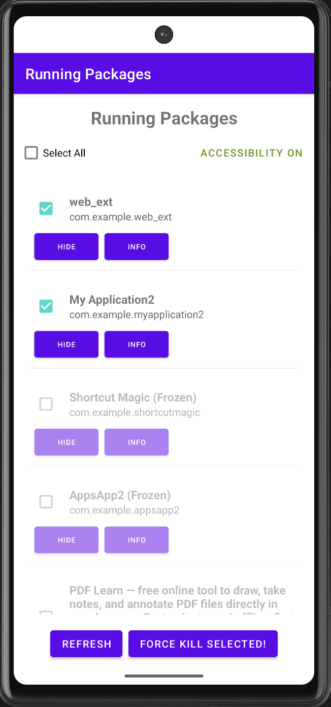

# BATTERIFY: ONE-BUTTON APP KILLER

# ⚡ THIS APPLICATION IS DESIGNED TO KILL BACKGROUND APPLICATIONS WITH A SINGLE BUTTON CLICK TO SAVE BATTERY POWER! ⚡

---

**Batterify** is a powerful utility designed to help you reclaim your device's battery life and performance. By automating the tedious process of force-stopping background applications, it ensures your phone stays fast and efficient.

## 🚀 Key Features

*   **ONE-CLICK TERMINATION**: Select multiple apps and stop them all in one go.
*   **ADVANCED AUTOMATION**: Leverages Android's Accessibility Service to handle system dialogs automatically.
*   **SMART FILTERING**: Automatically skips system-critical processes to keep your device stable.
*   **REAL-TIME VERIFICATION**: Ensures apps are actually stopped before marking them as "Frozen".
*   **CLEAN HISTORY**: Automatically closes system settings screens so they don't clutter your recent apps.

## 🛠 How to Use

1.  **Enable Accessibility**: Go to Settings > Accessibility and turn on **Batterify**.
2.  **Select Apps**: Open the app and check the boxes next to the applications you want to stop.
3.  **Kill Apps**: Tap the "Freeze" button and watch the automation do the work for you!

## ⚠️ Requirements

*   **Android 5.0+**
*   **Accessibility Service Permission**: Needed for clicking "Force Stop" buttons.
*   **Usage Access Permission**: Needed to see which apps are currently running.

## 📄 Disclaimer

Force-stopping applications will prevent them from running in the background. You may not receive notifications from stopped apps (like WhatsApp or Telegram) until you open them again manually. Use responsibly!

---
*Developed with love for Android performance.*
